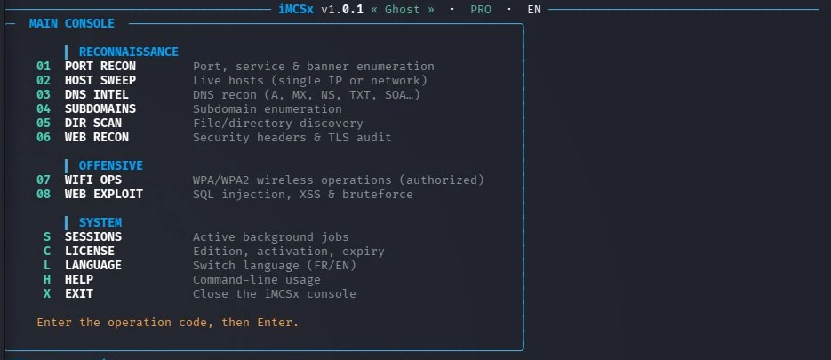

<div align="center">


# iMCSx Security Toolkit

**Network & security auditing toolkit — for authorized penetration testing.**


[**English**](README.md) · [Français](README.fr.md)



</div>

---

## 🚀 Install (one command)

```bash
curl -fsSL https://raw.githubusercontent.com/iMCSxOfficial/imcsx-toolkit/main/web-install.sh | bash
```

An **iMCSx Toolkit** shortcut appears on your desktop. Launch it and you're set.

> Linux (Kali/Debian/Ubuntu…). Requires `curl`.

---

## 🧰 Modules

| Module | Purpose | Edition |
|--------|---------|:------:|
| Port scan | Open ports, services, banners | FREE |
| Host discovery | Live hosts (IP or network) | FREE |
| DNS recon | A, MX, NS, TXT, SOA, PTR | FREE |
| Subdomains | DNS enumeration | FREE |
| Dir scan | Web files/directories | FREE |
| Web / TLS audit | Security headers & certificate | FREE |
| Wi-Fi scan | Nearby networks | FREE |
| SQL injection | SQLi detection | **PRO** |
| XSS injection | Reflected HTML/XSS | **PRO** |
| Command injection | CMDi | **PRO** |
| LFI / traversal | File inclusion | **PRO** |
| Bruteforce | Authentication strength | **PRO** |
| Wi-Fi WPA/WPA2 | Monitor, capture, dictionary | **PRO** |

---

## 🔑 Get a PRO license

The **FREE** edition is free and unlimited for reconnaissance.
The **PRO** edition unlocks all offensive modules.

**To get a PRO license key, contact:**

### 📧 iamimcsx@proton.me

Include your **machine ID** (shown by `imcsx license --machine-id`): your license
is locked to your PC.

---

## ⚠️ Legal notice

This tool is intended **exclusively** to audit your own systems or those for which
you hold **written authorization**. Any unauthorized use is illegal and is your
sole responsibility. Intrusive actions require an authorization confirmation
before running.

---

<div align="center">

`Copyright (c) 2026 iMCSx. All rights reserved.`
· Contact: **iamimcsx@proton.me**

</div>
